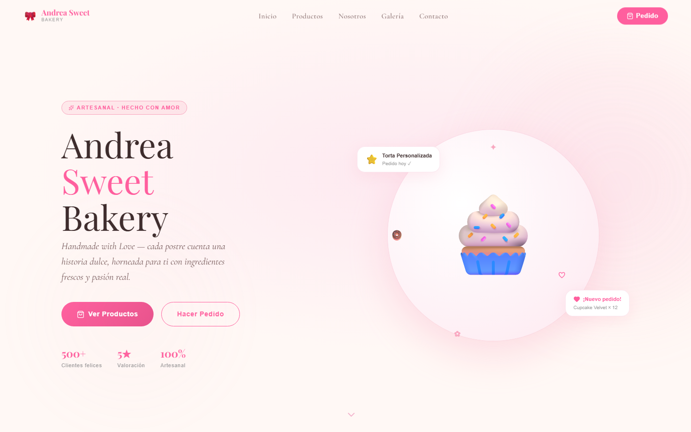
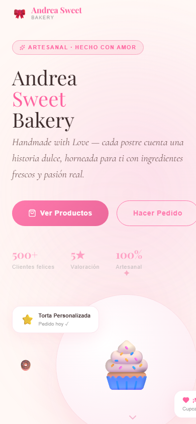

<div align="center">

# 🎀 Andrea Sweet Bakery

### *Handmade with Love — landing page para una repostería artesanal*

Landing page moderna, elegante y animada para **Andrea Sweet Bakery**,
una pequeña repostería con gran corazón 🧁

<br />

<a href="https://sweet-bakery-kappa.vercel.app">
  
</a>

<br /><br />


<br />


&nbsp;


</div>

<br />

## ✨ Características

- 🧁 **Hero animado** con cupcake flotante y tarjetas que orbitan a su alrededor
- 🎉 **Banner promocional** con texto en desplazamiento infinito
- 🛍️ **Catálogo de productos** con tarjetas que se elevan al pasar el cursor
- 👩‍🍳 **Sección "Nosotros"** con la historia de la repostería
- 📸 **Galería** estilo Instagram con efecto al pasar el cursor
- 📬 **Contacto** con formulario, WhatsApp, Instagram, dirección y correo
- 📱 **Totalmente responsive**, con menú adaptado para celular
- 🌀 **Animaciones al hacer scroll** en cada sección con Framer Motion

## 🍰 Productos destacados

| Producto | Precio |
|:---|---:|
| 🧁 Cupcake Velvet | $3.900 |
| 🍩 Donut Glaseado | $2.500 |
| 🍪 Macaron Duo | $4.200 |
| 🎂 Torta Cumpleaños | $28.000 |

## 🎨 Paleta de colores

| | Color | Hex | Uso |
|:---:|:---|:---:|:---|
|  | Rosa pastel | `#f9a8c0` | Acentos, bordes y decoraciones |
|  | Rosa fuerte | `#ff5f9e` | Botones y títulos destacados |
|  | Rosa suave | `#fde8f0` | Fondos de secciones |
|  | Crema | `#fff8f5` | Fondo principal |
|  | Chocolate | `#3d2c2c` | Texto principal |

Tipografías: **Playfair Display** (títulos) y **Cormorant Garamond** (textos), desde Google Fonts.

## 🛠️ Tecnologías

| Tecnología | Uso |
|:---|:---|
| ⚛️ **React 19** | Componentes y estado de la interfaz |
| ⚡ **Vite 8** | Servidor de desarrollo y compilación |
| 🎨 **Tailwind CSS 4** | Estilos utilitarios y diseño responsive |
| 🎬 **Framer Motion 12** | Animaciones y transiciones |
| 🔷 **Lucide React** | Íconos |
| ▲ **Vercel** | Hosting y despliegue |

## 🚀 Ejecutar en local

Necesitas [Node.js](https://nodejs.org) 20 o superior.

```bash
git clone https://github.com/Fernandamv96/sweet-bakery.git
cd sweet-bakery/sweet-bakery   # la app vive en esta subcarpeta
npm install
npm run dev                    # http://localhost:5173
```

Otros comandos:

```bash
npm run build     # compila para producción en dist/
npm run preview   # sirve la compilación localmente
npm run lint      # revisa el código con ESLint
```

## 📁 Estructura

```
sweet-bakery/
├── vercel.json              ← configuración de despliegue (compila la subcarpeta)
├── docs/                    ← capturas usadas en este README
└── sweet-bakery/            ← aplicación React + Vite
    ├── index.html
    ├── package.json
    ├── vite.config.js
    ├── postcss.config.js
    ├── public/
    └── src/
        ├── main.jsx         ← punto de entrada
        ├── App.jsx
        ├── SweetBakery.jsx  ← toda la landing page (secciones y animaciones)
        └── index.css        ← importa Tailwind
```

## ☁️ Despliegue

El sitio está publicado en Vercel: **https://sweet-bakery-kappa.vercel.app**

El archivo [`vercel.json`](vercel.json) le indica a Vercel que instale y compile la app desde
la carpeta `sweet-bakery/` y publique `sweet-bakery/dist`. Para desplegar desde tu equipo:

```bash
npm install -g vercel
vercel --prod
```

<br />

<div align="center">

Hecho con 🎀 y mucho ☕ en Santiago, Chile

*© 2026 Andrea Sweet Bakery*

</div>
